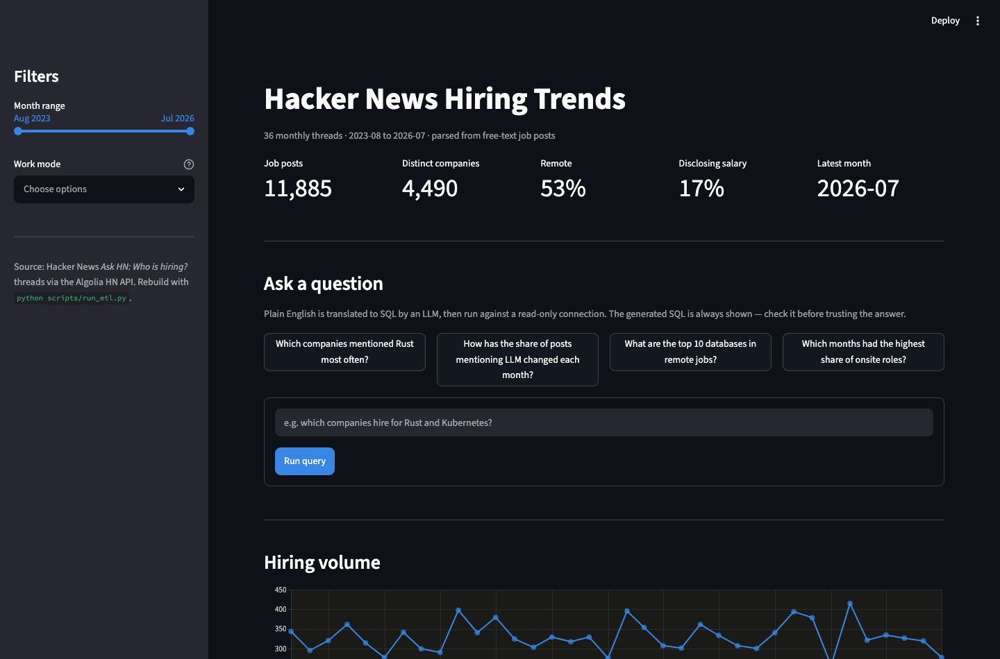
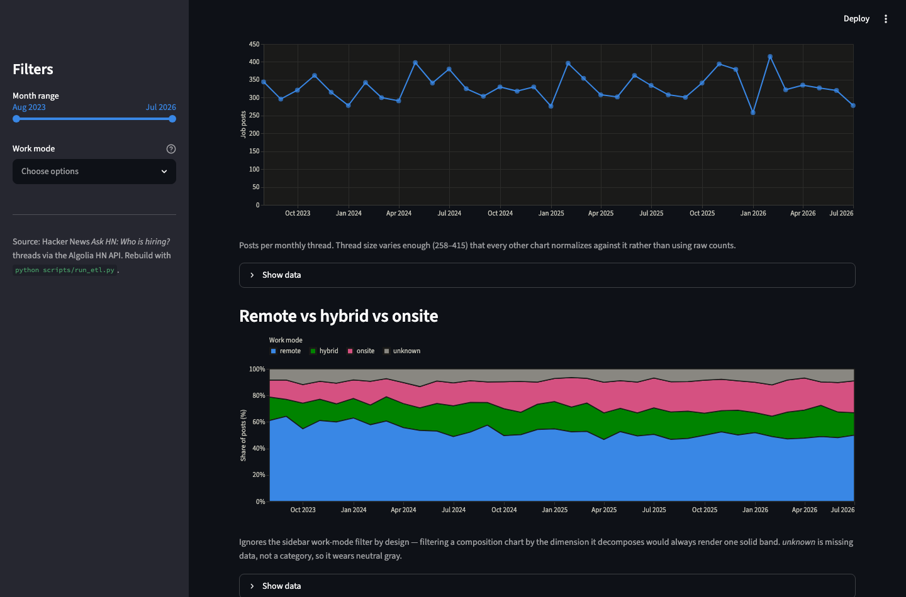
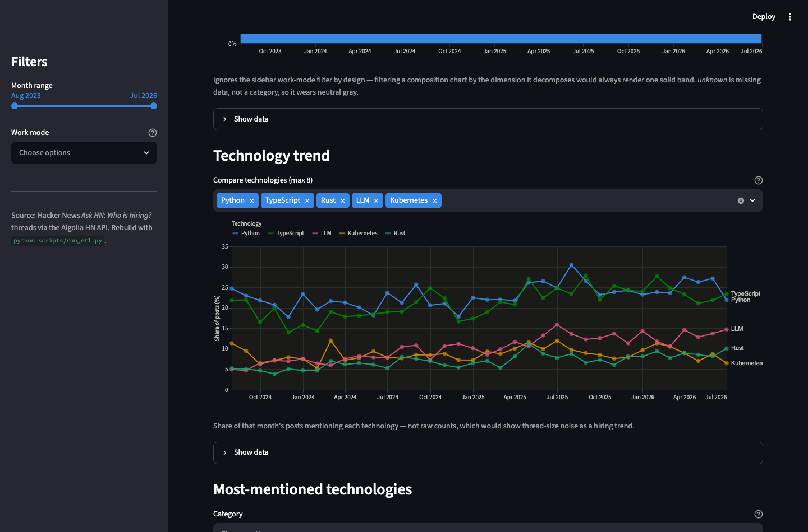

# Hacker News Hiring Trends

[](https://github.com/Shrey3008/hn-hiring-dashboard/actions/workflows/ci.yml)

An end-to-end analytics project over **11,885 job posts** from 36 months of Hacker
News *"Ask HN: Who is hiring?"* threads (Aug 2023 – Jul 2026): a Python/pandas ETL
that parses unstructured free text into a relational schema, a Streamlit dashboard,
and a natural-language query interface backed by an LLM.

Everything in it is free — free data source, free API, no paid hosting or database tier.



---

## What the data actually shows

The point of the project is the findings, not the plumbing.

**Remote work has been declining steadily for three years.** Remote fell from 60% of
posts to 49%, while onsite rose from 14% to 23% and hybrid stayed flat. The trend is
monotonic across 36 months, not noise:

| Year | Remote | Hybrid | Onsite |
|------|--------|--------|--------|
| 2023 *(Aug–Dec)* | **60.2%** | 16.0% | 14.0% |
| 2024 | 54.5% | 18.7% | 17.0% |
| 2025 | 50.6% | 19.0% | 22.0% |
| 2026 *(Jan–Jul)* | **48.9%** | 18.8% | **22.7%** |



**LLM/AI went from a niche mention to a top-6 technology.** Posts mentioning LLMs rose
from ~5% to ~15%, overtaking Kubernetes and Rust. Python, React, and TypeScript remain
the stable top three.



**Salary transparency nearly doubled**, from 13% to 26% of posts disclosing a range —
though see the limitations section before quoting that number.

---

## Architecture

```
Algolia HN API  ──fetch──▶  raw layer  ──parse──▶  curated layer  ──▶  Streamlit
                           threads               jobs                  charts
                           raw_posts             job_tech              NL query
                                                 dim_tech
```

The **raw layer is never edited after write**, and the curated layer is dropped and
rebuilt on every parse. That separation is why iterating on the parser takes 11
seconds instead of a 46-second re-fetch, and why `--parse-only` exists.

| Table | Rows | Purpose |
|---|---|---|
| `threads` | 36 | one row per monthly thread |
| `raw_posts` | 11,885 | verbatim API response, append-only |
| `jobs` | 11,885 | parsed fields, rebuildable |
| `job_tech` | 32,656 | tidy long table: one row per (post, technology) |
| `dim_tech` | 124 | curated keyword → regex → category lookup |

Storage goes through SQLAlchemy Core, so moving from SQLite to Neon Postgres is a
`DATABASE_URL` change and nothing else.

---

## Engineering notes

The parts worth reading. Each of these was found by testing, not by design.

### An LLM silently understated every percentage by 3x

The natural-language feature translates a question into SQL and runs it. Asked
*"how has the share of posts mentioning LLM changed each month?"*, the model produced
this — valid, fast, and **wrong**:

```sql
FROM jobs j LEFT JOIN job_tech t ON j.post_id = t.post_id
... SUM(CASE WHEN t.tech = 'LLM' THEN 1 ELSE 0 END) / COUNT(*)
```

`job_tech` holds one row per *(post, technology)* pair, so joining it fans each post
out into ~2.7 rows. `COUNT(*)` after that join counts **technology mentions, not
posts**. The denominator is inflated roughly threefold, and the query reported LLM at
**1.5%** for Aug 2023 against a true value of **4.9%**.

This is the failure mode that matters, and **no guardrail catches it.** The SQL is
safe, syntactically valid, returns instantly, and produces a plausible-looking
number. A reader has no signal that anything is wrong. Query guardrails defend
against *unsafe* SQL; nothing in them defends against *incorrect* SQL.

Three things came out of it:

1. **Fixed at the cause, in the prompt** — an explicit fan-out rule plus a worked
   example of the correct pattern (take the denominator from a separate aggregate
   over `jobs` alone; count the numerator with `COUNT(DISTINCT post_id)`).
2. **Verified against ground truth**, not by eyeballing. The dashboard's own
   `queries.tech_trend()` is the reference implementation; the LLM's output now
   matches it exactly (4.9 / 4.7 / 6.5), and generalizes to phrasings absent from
   the examples.
3. **The lesson generalized**: an LLM writing SQL against a schema with a
   many-to-many table will reach for the naive join. If you expose one, say so
   in the prompt explicitly.

The broader point: I only caught this because I had a validated query to compare
against. **An LLM query feature without a reference implementation to check it
against is a confident-wrong-answer generator.**

### The guardrails, and which one actually matters

Seven layers run between the model's output and the database:

1. strip markdown fences and SQL comments
2. reject multiple statements
3. require `SELECT` / `WITH`
4. reject DDL/DML keywords
5. wrap the query to force a row cap
6. execute on a read-only connection
7. abort on a statement timeout

**Only layer 6 is a real boundary.** A prompt instruction is not a security control,
and a keyword blocklist is a filter that someone eventually gets around. The
read-only connection is enforced by the SQLite driver itself, below the application.
`scripts/test_guardrails.py` asserts this directly — it bypasses validation entirely
and confirms the connection refuses a `DELETE`.

Two details that are easy to get wrong:

- **Comments are stripped before the keyword scan**, because `SELECT 1 --\nDROP TABLE
  jobs` hides a second statement from a scanner reading raw text.
- **The row cap wraps rather than appends.** Appending `LIMIT` is unsafe with CTEs,
  compound `SELECT`s, and queries carrying their own larger `LIMIT`. Wrapping as
  `SELECT * FROM (…) LIMIT 500` caps all of them uniformly.

Adversarial prompts (direct injection, *"delete every row"*, a legitimate question
with a `DROP` rider appended, `PRAGMA`) were all refused or answered safely, with row
counts unchanged afterward.

### Measuring correctness: a 25-case eval set

Guardrails stop unsafe SQL; nothing in them stops SQL that is safe and wrong. So the
natural-language feature has an evaluation harness (`src/evals/`, details in
[`src/evals/README.md`](src/evals/README.md)):

- **25 questions, each with a reference SQL query.** The model's query and the
  reference both run against the same read-only database and the *results* are
  compared, never the SQL text.
- **Saved baseline:** `openai/gpt-oss-120b` passed **24 of 25 (96%)** on 2026-09-23
  (`eval_results/baseline.json`). The one failure is the kind this project exists to
  catch: *"What percentage of posts in 2026 mentioned Python?"* has a true answer of
  24.9%, and the model's query ran without error but returned a different number.
- **The harness is tested too.** `scripts/test_eval_harness.py` swaps the model for
  three fakes (always right, reintroduces the fan-out bug, invents answers) and
  asserts the scores move exactly as they should: 19 assertions, no API key.
- **CI:** every push runs the guardrail checks, validates the eval set and runs the
  harness calibration. The live model run against the baseline
  (`run_evals.py --baseline ... --min-accuracy 0.80`, exit code 1 on a regression) is
  a manually started workflow job that needs a `GROQ_API_KEY` repository secret.

### The schema in the prompt is generated, never written

The DDL handed to the LLM is compiled from live SQLAlchemy metadata. A hand-maintained
copy drifts the moment a column is renamed — and a prompt that disagrees with the
database produces confidently wrong SQL rather than an error.

On top of the DDL it injects what DDL can't express: exact `work_mode` values, the
month range, the fact that SQLite booleans are 0/1, and **all 124 technology names
verbatim**. Without that last part the model guesses `postgres` for `PostgreSQL` and
returns zero rows — again, a wrong answer wearing the costume of a valid one.

### Colors were validated, not chosen

The categorical palette is checked programmatically for colorblind separation and
contrast at every series count the dashboard can render.

The first implementation assigned each technology a color by its popularity rank
mod 8 — which put Python (rank 0) and Rust (rank 8) on the same blue, in the default
selection. The obvious fix (bump collisions to the next free slot) produced
non-consecutive palette subsets, and the palette only guarantees separation between
*adjacent* slots: slots {0,1,2,5,6} put magenta beside orange at ΔE 11.6 against a
floor of 15 — two series that even full-colour readers struggle to tell apart. Series
now occupy consecutive slots, validated at every count from 2 to 8 in both light and
dark mode.

---

## Data quality

Extraction rates are **measured, not assumed** — run `python scripts/parse_report.py`:

| Field | Coverage |
|---|---|
| structured header | 90.1% |
| company | 90.6% |
| work mode | 90.7% |
| location | 74.3% |
| ≥1 technology | 70.5% |
| role title | 62.3% |
| salary range (USD) | 16.7% |

About 90% of posts open with a pipe-delimited header (`Company | Role | Location |
Remote`), but **only position 1 is reliable** — the remaining fields appear in any
order. So they're classified by *content* (does it look like money? a work mode? a job
title?) rather than by position.

### Known limitations

These are deliberate trade-offs, not oversights:

- **Go is undercounted.** It matches only `\bgolang\b`. Matching the English word
  "go" would flood the chart with false positives. Real Go demand is higher than shown.
- **Salary is a floor, not a rate.** Only explicit USD *ranges* are parsed. Single
  figures (`$150k`) and non-USD postings count as undisclosed. Mixing currencies would
  make the distribution meaningless. The *trend* is still credible because the bias is
  constant across months.
- **Role title is 62%**, but 87% of the misses are posts with no role in the header at
  all — genuine absence, not extraction failure.
- **Technology mentions are unweighted.** A technology named once in a laundry list
  counts the same as the core stack.
- **Companies are not deduplicated** beyond case and whitespace normalization, so
  "Acme" and "Acme Inc" are two companies.
- **Work-mode detection runs a negation pass first**, so `"no remote"` is not read as
  a remote job. Without it the headline chart would be wrong.

---

## Running it locally

### Setup

⚠️ **Use `uv`, not `python -m venv`.** Homebrew's `python@3.12` and `@3.13` bottles are
broken on macOS 26.1 — their `pyexpat` links against a newer `/usr/lib/libexpat` than
the OS ships, so `pip` cannot even bootstrap. `uv`'s self-contained CPython builds
avoid this entirely.

```bash
brew install uv
uv venv --python 3.12 .venv
uv pip install --python .venv/bin/python -r requirements.txt
```

The repository ships a committed database snapshot, so **the dashboard runs
immediately with no ETL step**:

```bash
.venv/bin/streamlit run app.py
```

### Rebuilding the data

```bash
python scripts/init_db.py            # schema + tech keyword lookup
python scripts/run_etl.py            # fetch 36 threads, then parse  (~57s)
python scripts/parse_report.py       # extraction-quality report
```

| Command | Effect |
|---|---|
| `run_etl.py --parse-only` | re-parse without re-fetching (~11s) — the iteration loop |
| `run_etl.py --months 12` | smaller window |
| `run_etl.py --force` | re-fetch threads already stored |

### Natural-language queries

Get a free key at [console.groq.com](https://console.groq.com):

```toml
# .streamlit/secrets.toml   (gitignored)
GROQ_API_KEY = "gsk_..."
# GROQ_MODEL = "openai/gpt-oss-120b"       # optional override
```

Groq retires model ids periodically. If the default 404s:

```bash
python -c "import sys; sys.path.insert(0,'.'); \
  from src.nl_query import available_models; print(*available_models(), sep='\n')"
```

### Tests

```bash
python scripts/test_guardrails.py    # 30 checks, no API key needed
python scripts/run_evals.py --dry-run # validates the 25-case eval set, no API key
python scripts/test_eval_harness.py  # 19 harness-calibration assertions, no API key
python scripts/run_evals.py          # live eval: one Groq API call per case
```

---

## Deployment (Streamlit Community Cloud, free)

The repo commits `data/snapshot.db`, a read-only build with `raw_posts.text_html`
nulled out — nothing reads it at runtime, and excluding it halves the file from 40 MB
to 19 MB. The full local build stays gitignored so rebuilds don't add a 40 MB blob to
history on every commit. `get_database_url()` prefers a local build if present and
falls back to the snapshot, so a fresh clone and the deployed app both just work.

1. Push to a **public** GitHub repository.
2. At [share.streamlit.io](https://share.streamlit.io), create an app pointing at
   `app.py` on the default branch.
3. In the app's **Settings → Secrets**, add:
   ```toml
   GROQ_API_KEY = "gsk_..."
   ```
   Streamlit Cloud has its own secrets store — the local `.streamlit/secrets.toml`
   is gitignored and never reaches the server.

To refresh the deployed data: `python scripts/run_etl.py && python
scripts/build_snapshot.py`, then commit the new `data/snapshot.db`.

To switch to Neon Postgres instead, set `DATABASE_URL` in Streamlit Cloud's secrets;
no code changes are required.

---

## Project structure

```
app.py                        Streamlit UI
src/
  db.py                       SQLAlchemy schema, engine, read-only mode
  fetch.py                    Algolia HN API  ->  raw layer
  parse.py                    raw layer       ->  curated layer
  queries.py                  chart-backing SQL
  theme.py                    validated chart palette
  nl_query.py                 LLM -> SQL, guardrails, execution
  evals/                      25-case eval set, runner, result comparator
scripts/
  init_db.py                  create schema, load tech keywords
  run_etl.py                  fetch + parse
  parse_report.py             extraction-quality report
  build_snapshot.py           build the committed deploy database
  test_guardrails.py          SQL guardrail tests
  run_evals.py                run the eval set (dry run, live, baseline gate)
  test_eval_harness.py        calibrates the eval harness with fake models
  capture_screenshots.py      README screenshots (dev only)
data/
  dim_tech.csv                124 technology keywords + regexes
  snapshot.db                 committed read-only database
```

**Stack:** Python 3.12 · pandas · SQLAlchemy Core · SQLite · Streamlit · Altair ·
Groq (openai/gpt-oss-120b) · Algolia HN API
